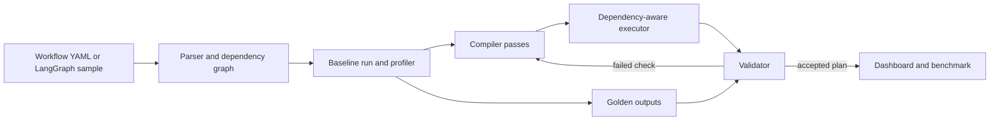

# SYNAPSE

**A dependency-aware compiler and runtime for AI agent workflows.** SYNAPSE reads an existing workflow, finds work that can safely overlap or be reused, and measures whether the compiled version is faster while preserving its checked outputs.

The headline demonstration is a **synthetic bank loan pre-screening agent**. The original workflow runs 11 steps in file order. SYNAPSE builds a dependency graph, removes an unused offer lookup, merges a duplicate policy lookup, overlaps independent checks, and caches eligible results. A validator tests each change against the original before accepting it. A second complaint triage workflow and a LangGraph research example show that the compiler is not tied to the loan agent.

All bank customers, accounts, policy passages and service responses in this repository are synthetic. The demo is not connected to a bank and is not a production credit or complaint decision system.

## See it run

From the repository root, with Conda and `make` installed:

```bash
make setup      # creates the Python 3.12 "synapse" environment; downloads the local embedding model
make test       # offline tests; no real model or external API calls
make bench      # measured mock ablation, 20 loan cases × 10 repeats by default
make demo       # profiles and validates, then serves http://127.0.0.1:8000
```

Open [the local dashboard](http://127.0.0.1:8000). It has six views: workflow graphs, an execution timeline, compiler decisions, validation, benchmarks, and a live side-by-side mock run. The timeline puts the original and compiled traces on the same axis so overlapping work is visible. `make bench` writes `bench/results/latest.json`; run it before `make demo` if you want benchmark data on the screen immediately. The results and SQLite traces are generated locally and ignored by Git.

Open the dashboard through the server URL above. Opening `ui/index.html` as a local file displays the source page without its API or assets.

For a quick terminal demonstration without the dashboard:

```bash
conda run -n synapse synapse run workflows/loan_prescreen.yaml --case A01 --latency-scale 0.01
conda run -n synapse synapse compare workflows/loan_prescreen.yaml --case A01 --latency-scale 0.01
conda run -n synapse synapse validate workflows/loan_prescreen.yaml --unsafe-route-risk --latency-scale 0.001
```

The third command deliberately tries to route the final risk decision to a weak mock model. It should print a rejection reason while retaining the safe plan. `--latency-scale` changes **simulated mock delays**; it does not scale Python or model execution time.

## How it works



Each node declares what it reads, what it produces, and its effect: `pure`, `read`, or `write`. The parser catches missing inputs, cycles and undeclared outputs. In baseline mode, the executor awaits every node in YAML order. In compiled mode, a node starts when all producers of its inputs have finished, subject to write-order barriers and a model concurrency cap.

In the loan workflow, statement fetching and policy retrieval can begin while the application is parsed. After parsing, KYC, bureau and segment classification can overlap. `risk_summary` waits for all of their outputs; `notify_customer` waits for the risk decision. The compiler currently supports:

| Pass | Change | Safety condition |
| --- | --- | --- |
| Compact inputs | Remove JSON whitespace and repeated table keys | Every field/value survives; templates and schemas stay intact; writes are excluded. |
| Dead nodes | Remove unused work | Never removes a write, a `required: true` check, or a producer of a declared workflow output. |
| Common subexpressions | Merge equivalent calls | Requires the same behavior and safe effect; reads cannot merge across an intervening write. |
| Parallel execution | Start independent nodes together | Data dependencies and write barriers remain in force. |
| Exact memoisation | Reuse repeated results | Keys include inputs, node configuration and model provider; reads expire and writes invalidate cached reads. |
| Model routing and cascade | Try a smaller model on checkable steps | Requires validation evidence; a schema failure retries on the large model. Final decision steps stay on the large model. |

A missing effect tag is treated as `write`. A write is never removed, merged, cached or reordered against another write. The validator runs the original twice to measure natural output variation, then tests compiler changes incrementally on the same cases. Structured outputs must satisfy their JSON Schema; decision fields and non-text fields are checked exactly; free text is compared for similarity. A failing pass is rejected with a reason.

## Workflows

| Workflow | What it exercises | Cases | Command |
| --- | --- | ---: | --- |
| `loan_prescreen.yaml` | Application parsing, KYC, bureau, statement and policy checks, risk decision, SMS write | 20 | `synapse compare workflows/loan_prescreen.yaml --case A01` |
| `complaint_triage.yaml` | Complaint classification, transaction and policy reads, reply draft, ticket write | 17 | `synapse compare workflows/complaint_triage.yaml --case C01` |
| `research_llm_langgraph.py` | Two local evidence searches, one structured model answer with citations and an unsupported-answer flag | 20 | Select `research_llm` and any configured model in the dashboard |
| `research_agent_langgraph.py` | Importing a LangGraph DAG and overlapping two retrieval and summary branches | 20 | `synapse import-langgraph workflows/research_agent_langgraph.py --show-graph --run` |

The complaint reply is a draft for human review, and the policy corpus is explicitly synthetic. The research cases come from the [HotpotQA dataset](https://huggingface.co/datasets/hotpotqa/hotpot_qa); its local answer function demonstrates scheduling and output preservation, **not question-answering accuracy**. Conditional LangGraph branches can be represented as gate nodes but are not executable yet.

## Commands

| Command | Purpose |
| --- | --- |
| `synapse run WORKFLOW --case ID [--mode compiled]` | Run one synthetic case or all cases; print the result and timing. |
| `synapse compile WORKFLOW --show-graph --explain` | Show the graph and each compiler decision. `--explain` uses stored mock baseline profiles. |
| `synapse profile WORKFLOW --case ID --runs N` | Record node timings, tokens, model costs, retries, CPU and memory in `data/synapse.db`. |
| `synapse compare WORKFLOW --case ID` | Run baseline and compiled versions on the same case. |
| `synapse validate WORKFLOW [--unsafe-route-risk]` | Check candidate passes against golden runs; the unsafe switch is for the loan mock demo. |
| `synapse bench [WORKFLOW ...] [--cases A01,A03] [--steps baseline,parallelise]` | Measure pass-by-pass cold and warm results. |
| `synapse import-langgraph MODULE --show-graph --run` | Import and validate a supported LangGraph DAG. |

The mock bank can also run as a separate local service with `make mock`; pass `--bank-url http://127.0.0.1:8001` to `synapse run`. `make api` starts the dashboard API without first profiling or validating.

### Benchmark method

`make bench` uses the same executor, cases and concurrency cap for each configuration. It adds dead-node removal, duplicate merging, lossless input compaction, parallel execution, model routing, then caching one step at a time. By default it runs every case in all four workflows 10 times. The dashboard shows original and optimized input/output tokens, their total, estimated cost per case, and the measured difference. It also shows cache-cold median and p95 latency, model calls, critical path and correctness. A separate warm result represents repeat requests with a prefilled cache. The default mock delay scale is `0.01`, recorded in the output JSON so runs at different scales are not confused. Mock cost units are reproducible comparison units, **not dollars**. Results vary by machine and load. A bundled three-repeat synthetic example populates the dashboard on a fresh checkout until `make bench` writes local results.

The bundled three-repeat example at scale `0.01` measured these cache-cold means per case:

| Workflow | Tokens, original → optimized | Mock cost, original → optimized | Correct optimized runs |
| --- | ---: | ---: | ---: |
| Loan pre-screen | 1,950.4 → 1,520.8 | 19.504 → 6.750 units | 60/60 |
| Complaint triage | 1,479.2 → 1,437.8 | 14.792 → 14.378 units | 51/51 |
| Research scheduling sample | 0 → 0 | 0 → 0 units | 60/60 |
| Model-backed research | 768.6 → 766.0 | 7.686 → 7.660 units | 60/60 |

Loan inputs shrink by 23.9% in this simulation; complaint inputs by 3.3%. Large cost reductions
in the mock loan benchmark also include validated model routing, which live runs do not inherit
without provider-specific validation. Parallel execution alone cannot reduce token counts.
The single-call research workflow has little redundant input and its tiny local searches do
not yield a meaningful cold speedup (17.9 → 18.3 ms in this sample). Do not interpret output
preservation as research answer accuracy. These are controlled simulation results, not bank
results. The bundled data are in `bench/sample_mock.json`; local measurements replace them.

For a short local check:

```bash
conda run -n synapse synapse bench --cases A01,A03 --repeats 1 --latency-scale 0.001
```

## Optional live model calls

Mock mode is the default and is sufficient for the whole demo. To call a real model, copy `.env.example` to `.env`, set `GOOGLE_API_KEY` (or configure Groq in `config/models.yaml` with `GROQ_API_KEY`), and add `--live` to `run`, `compare`, `profile`, `validate`, or `bench`. The `.env` file is ignored by Git. LangSmith tracing is optional through the variables shown in `.env.example`.

**`--live` changes only the LLM calls.** Bank tools still use the local mock bank, retrieval still uses local synthetic policies, and all cases remain synthetic. Gemini has been exercised end to end; Groq GPT-OSS 20B and 120B have each completed complaint case C01. Live calls may consume provider quota. Live cost figures are estimates at the configured paid-tier token rates, even when an account is on a free tier. Mock and live benchmark files are kept separately.

The dashboard's Live run screen offers Mock, Gemini 3.1 Flash-Lite, Gemini 3.5 Flash, Groq GPT-OSS 20B, and Groq GPT-OSS 120B. Live runs default to one compiled execution; select **Compare both** when you want to spend requests on both versions and see their measured token and estimated USD costs side by side. A compiled-only run shows its own usage; it cannot claim an original-run cost without making those extra calls. Pricing uses the selected model's actual rate, even if the workflow labels its node with another tier. The original `research_agent` is a scheduling-only example with zero model calls. The new `research_llm` has a real structured answer step and works with the selected provider. Its two local searches run concurrently in the compiled plan, then one synthesis call cites evidence; it avoids two intermediate model summaries by design. The local SQLite quota ledger reserves requests and tokens before each call, survives server restarts, and shows remaining local budget beside the selector. Minute pacing uses conservative caps below [Groq's published free limits](https://console.groq.com/docs/rate-limits);
[Gemini limits](https://ai.google.dev/gemini-api/docs/rate-limits) vary by project/model.
Daily exhaustion is **advisory**: models stay selectable and each uncached call tries the
provider again after minute pacing. A daily quota rejection ends that run immediately without
repeated daily-limit retries. A successful call clears the old provider warning. This ledger
cannot see use in other apps or guarantee a free-tier allowance.

The dashboard separately shows total elapsed time, summed quota/retry waits, provider call
time, input/output tokens, actual-model priced cost and each step's usage. A slower/more
expensive result is a red regression, never a green speedup. Per-call waits may overlap and
are not subtracted from run time to manufacture an adjusted speedup. A model can vary output
length even at temperature zero. Groq uses [strict structured output](https://console.groq.com/docs/structured-outputs)
for the supported GPT-OSS models; local schema validation remains in place.

Select **Reuse exact results** to retain compiled model answers between identical runs in
this server session. The first run is cold; subsequent exact matches are warm and may avoid
all model calls. Fresh bank reads still occur after writes, and each SMS/ticket write still
executes once per run. Keys include model/provider, inputs, prompt/schema contents and node
settings. Cold is the default; do not compare warm reuse with cold execution as a compiler
speed benchmark. Completed traces, including failed-call usage and waits, persist in SQLite.

LangGraph modules can declare `NODE_SPECS` for every node to import I/O without executing any
function. This is required for read/write services and async model calls. The original pure
scheduling example still supports tracing. `research_llm_langgraph.py` can also be run natively
with `build_graph(adapter).compile()`, using the same adapter contract. Conditional gates
still fail closed until branch execution is implemented.

Routing evidence is tied to the workflow, prompt and schema contents, full case suite, provider, and model names. The API runs a compiled live plan without routing until those live models pass validation; an explicitly requested routed plan is rejected until then.

## Repository map

```text
workflows/          Loan, complaint and LangGraph example workflows
prompts/            Prompt templates and JSON Schemas
mock_services/      Synthetic cases, deterministic mock LLM tasks and mock bank API
synapse/            Parser, graph, passes, executor, validator, profiler, store and API
bench/              Repeated cold/warm benchmark harness
ui/                 Offline dashboard assets
config/             Mock delays, model mapping and cost rates
tests/              Offline unit and integration tests
```

## Team repository rules

This is a private hackathon repository. Push work without rewriting history. Do not commit `.env`, credentials, the team's execution plan PDF, or real customer data. Do not change repository visibility or add people outside the team.
